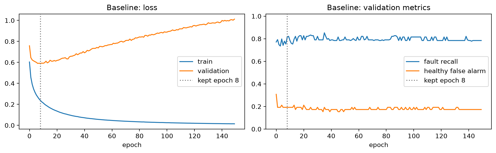
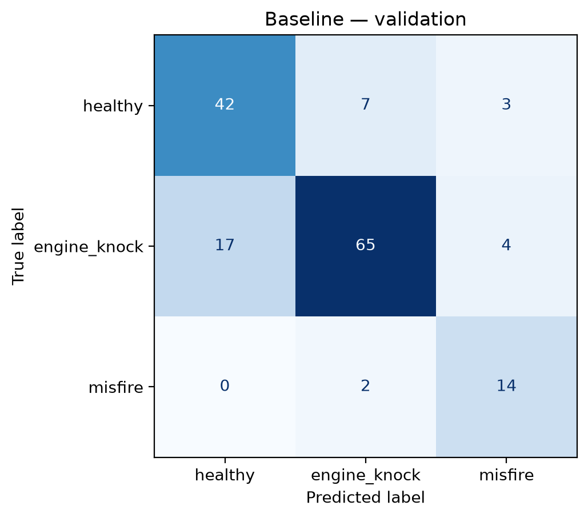
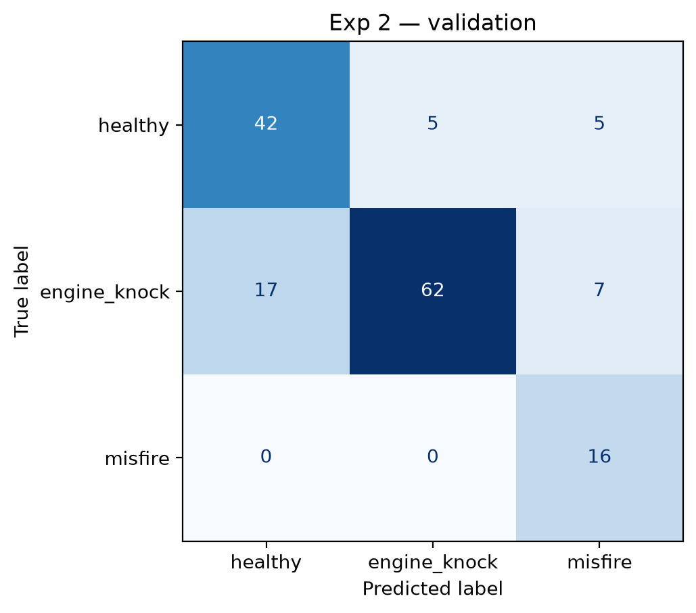
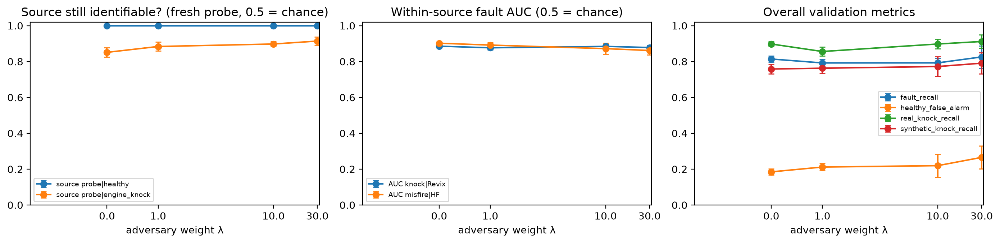

```{python}
from decimal import ROUND_HALF_UP, Decimal

import pandas as pd

R = "../results"
log = pd.read_csv(f"{R}/experiment_log.csv").set_index("run")
within = pd.read_csv(f"{R}/within_source.csv", index_col=0)


def pct(x):  # round half up, so 0.815 -> 0.82 as in the prose
    return str(Decimal(str(x)).quantize(Decimal("0.01"), ROUND_HALF_UP))
```

> **Draft status.** Numbers come from `notebooks/engine_fault_classification.ipynb` (validation split).
> Items marked **TODO** are still open: the final test-set evaluation, a multi-seed check of Experiment 2, and
> listening to the misclassified clips. Every section should be rewritten in the team's own words.

# Business problem

**Client.** The maintenance manager of a regional delivery fleet (~200 light vehicles) and the service writers who
schedule shop time.

**Problem.** Engine faults such as *knock* (uncontrolled combustion that can damage pistons and bearings) and
*misfire* (a cylinder failing to fire, which wastes fuel and can damage the catalytic converter) are expensive when
caught late. Drivers notice "a weird noise" inconsistently, and technicians have limited time to triage complaints.

**Current process.** Drivers report problems verbally; a technician listens and runs an OBD-II scan. The engine
computer flags many misfires with trouble codes, but intermittent or early problems may not set a code, and knock is
often only heard. Without AI, the alternative is more frequent scheduled inspections.

**What would make AI useful.** A 10-second phone recording, taken during a routine pre-trip check, that flags
vehicles likely to need an engine inspection. It needs no new hardware, and its job is to *prioritise* inspections,
not replace the mechanic.

**Cost of wrong predictions.** A *missed fault* (false negative) lets a damaged engine keep running: possible engine
or catalytic-converter repairs costing thousands, plus downtime. A *false alarm* (false positive) costs one
unnecessary inspection (~30 min of technician time), and frequent false alarms erode trust in the tool. Missed faults
are far more costly, so we prioritise recall while capping false alarms.

# Model, data, and adaptation

**Model.** The Audio Spectrogram Transformer (AST, 86 M parameters) [1], fine-tuned by its authors on AudioSet [2],
a 2-million-clip collection of labelled YouTube sounds that includes engine and vehicle categories. We chose it
because it is a strong, widely used general-purpose audio model that runs from the Hugging Face `transformers`
library and accepts our 16 kHz audio directly. **Alternative:** BEATs [3], a self-supervised audio model of
similar size; for on-device use, a much smaller model such as YAMNet would be the reasonable option.

**Dataset.** KweriMoto Engine Sounds [4]: 1,067 mono 16 kHz clips (≤ 10 s) labelled `healthy` (351),
`engine_knock` (608), or `misfire` (108), with predefined splits that keep every clip from a recording in one
split — train 721, validation 154, test 154 — plus a separate `real_test` set of 38 real knocks. We verified there is
no leakage between splits, including through the synthetic clips (see below).

**Limitations relative to the business use.** This dataset is not a fleet's recordings, and its structure creates a
serious risk that a model learns *where a clip came from* instead of *what is wrong with the engine*:

- All misfire clips come from a single source; all AudioSet clips are knocks.
- Half of the knock clips are **synthetic** — an AudioSet knock sound mixed over a healthy car recording.
- `real_test` contains only knocks, so it cannot measure false alarms.
- No information about vehicle, microphone position, or engine speed; labels are not mechanic-confirmed.

**Adaptation.** (a) *Feature extraction:* AST is frozen and each clip becomes a 768-number summary; a linear
classifier (2,307 parameters) is trained on top. (b) *Partial fine-tuning:* the top two AST layers are also trained.

# Success criteria (set before training)

| | Choice | Why |
|---|---|---|
| Model metric | **Fault recall**: average recall over knock and misfire | Missed faults are the costly error |
| Guardrail | **Healthy false-alarm rate**: share of healthy clips flagged | Too many false alarms → tool ignored |
| Business criterion | Catch **≥ 85 %** of faulty engines while flagging **≤ 20 %** of healthy ones | Useful as a triage aid |
| Operational constraint | **< 1 s per 10 s clip on a laptop CPU** | Runs on a shop PC or phone backend, no GPU |

All model selection used the validation split; the test split is reserved for one final evaluation.

# Experiments

We compared a majority-class benchmark, a baseline, and three experiments that each change one variable
(Table 1). All runs use the same splits and selection rule (keep the epoch with the lowest validation loss).

```{python}
#| output: asis
cols = {"fault_recall": "Fault recall", "healthy_false_alarm": "False alarm", "real_knock_recall": "Knock (real)",
        "synthetic_knock_recall": "Knock (synth.)", "misfire_recall": "Misfire"}
t = log[list(cols)].rename(columns=cols).map(pct)
t.insert(0, "Change", log["change"])
print(t.reset_index().rename(columns={"run": "Run"}).to_markdown(index=False, disable_numparse=True))
print("\n: Validation results. Benchmark = always predict *knock* (the most common class). {#tbl-runs}")
```

**Baseline (frozen AST + linear head).** Fault recall 0.82 with a 0.19 false-alarm rate — far above the benchmark,
but just short of the 85 % target. Validation loss is lowest at epoch 8 and rises afterwards (@fig-curves): with only
721 training clips, even a linear head overfits quickly, so early stopping matters.

**Experiment 1 — partial fine-tuning.** *Expected:* adapting the top layers would help separate a knock from
surrounding engine noise. *Happened:* knock recall improved (0.76 → 0.86), but misfire recall fell
(0.88 → 0.75), so fault recall did not improve (Section 6).

**Experiment 2 — class-weighted loss.** *Expected:* weighting the rare misfire class (76 training clips) more
heavily would raise misfire recall. *Happened:* misfire recall reached 16/16 and fault recall 0.86 with no change in
false alarms — the only configuration meeting both criteria. *Learned:* the weights moved some errors from misfire to
knock; the gain is two clips, so it needs confirming (**TODO:** repeat over 5 random seeds).

**Experiment 3 — no synthetic knocks in training.** *Expected:* if synthetic knocks teach the real knock sound,
removing them should hurt real-knock recall. *Happened:* real-knock recall *rose* (0.84 → 0.93) while
synthetic-knock recall collapsed (0.67 → 0.42). *Learned:* the synthetic clips did not teach the real knock sound —
but since every real knock comes from AudioSet, high real-knock recall may partly reflect recognising AudioSet audio.

{#fig-curves width=95%}

# Evaluation

## How well does it perform?

The best configuration on validation (Experiment 2) catches 86 % of faults and flags 19 % of healthy engines
(@fig-confusion). Inference takes ≈ 0.6–0.8 s per clip on a laptop CPU (40 ms on GPU), meeting the operational
constraint; the classifier adds negligible cost.

::: {#fig-confusion layout-ncol=2}




Validation confusion matrices (rows: true class; columns: predicted).
:::

> **TODO — final test evaluation.** Choose the final configuration, set `RUN_FINAL_EVAL = True` in the notebook,
> and report test metrics and `real_test` knock recall here. Run once.

## Where does it fail?

Of 33 baseline validation errors, 13 are synthetic knocks predicted as healthy. Three representative cases
(**TODO:** listen to each clip and describe what is audible):

1. **`revix_car_knocking_0043` — knock predicted healthy with 97 % confidence.** A 4.1 s synthetic clip. Short
   knock clips (< 5 s) are misclassified 55 % of the time (6 of 11) versus 20 % for longer ones; AST pads short
   clips with silence, leaving fewer knock events to detect. *Consequence:* a confidently missed fault — the costly
   error.
2. **`audioset_9wGJydlJvrk_30000` — a real knock predicted healthy (95 %).** Real-world recordings vary in
   microphone, distance and background noise; with a single source of real knocks the model has little variety to
   learn from. *Consequence:* the failure mode most relevant to deployment.
3. **`hf_healthy_059` — healthy predicted misfire (92 %).** Healthy and misfire clips from this source share
   recording conditions, so the model must rely on subtle differences in engine rhythm. *Consequence:* an
   unnecessary inspection — cheaper, but repeated false alarms reduce trust.

Because a missed fault costs far more than a false alarm, we favour configurations with higher fault recall even at a
slightly higher false-alarm rate, and recommend reporting a confidence score so borderline cases can be reviewed.

## Is the model hearing the fault, or the source?

A linear probe on the same AST features identifies a clip's source with **95 %** accuracy (chance 54 %), and
**98 %** among healthy clips alone. We ran three further checks (notebook Section 9):

```{python}
#| output: asis
w = within.loc[["Baseline", "Exp 2 (class weights)", "Exp 3 (no synthetic)"]].map(pct)
w.columns = ["Knock vs healthy (Revix only)", "Misfire vs healthy (HF only)"]
print(w.reset_index().rename(columns={"index": "Model"}).to_markdown(index=False, disable_numparse=True))
print("\n: ROC AUC when the recording source is held fixed (0.5 = chance). {#tbl-within}")
```

- **Within-source tests (@tbl-within):** comparing clips from the *same* source, the model still separates faulty
  from healthy well (AUC ≈ 0.87–0.89). The features carry real fault information — with the caveat that the Revix
  "knocks" are overlaid sounds and the misfire test has only 28 clips.
- **Zero-shot baselines:** CLAP [5], an audio–text model used with no training, scores below the benchmark (fault
  recall 0.22), confirming that off-the-shelf models do not know engine faults. AST's own "Engine knocking" output
  detects AudioSet knocks far better than synthetic ones (AUC 0.86 vs 0.62), consistent with AST having seen these
  clips during pre-training.
- **Source-adversarial training:** we trained the representation to hide the source within each class [6]. The
  adversary was partly fooled, but a fresh probe still identified healthy-clip sources **perfectly** at every
  setting (@fig-adv), a known weakness of adversarial removal [7]. The source fingerprint cannot be trained away.

{#fig-adv width=100%}

# An unsuccessful experiment: partial fine-tuning

1. **Why we expected improvement.** AudioSet features are generic ("engine", "vehicle"); training the top layers
   should specialise them to engine faults, a standard way to improve transfer learning.
2. **What happened.** Fault recall stayed flat (0.82 → 0.81) and false alarms rose slightly (0.19 → 0.21), at
   ~6,000× more trainable parameters (14.2 M), minutes instead of seconds of training, and a 345 MB model to deploy.
3. **Evidence.** Validation loss bottomed out at epoch 2 while training loss kept falling, a sign of rapid
   overfitting. Knock recall rose but misfire fell from 14/16 to 12/16: the model improved on the class with the most
   training data (399 knocks) at the expense of the smallest (76 misfires).
4. **What we learned.** With ~700 clips, more model capacity mainly fits the majority class; the bottleneck is
   data, not model flexibility.
5. **Effect on our recommendation.** We prefer the frozen model: equally accurate on our primary metric, far
   cheaper to train, store and update.

# Recommendation: continue development (not yet a pilot)

The approach is promising: a frozen pre-trained model with a tiny classifier meets the business criterion on
validation (Experiment 2), runs in under a second on a laptop CPU, and still separates faults from healthy engines
when the recording source is held fixed. **We do not recommend a pilot yet**, because:

- We cannot rule out that much of the performance comes from recognising the recording source; even adversarial
  training could not remove it.
- All misfire examples come from one source, and no test set measures false alarms on real knocks.
- Validation differences between configurations are 1–2 clips, so the choice of configuration is not yet stable.

**Next step (≈ 4–6 weeks):** collect the fleet's own recordings — same phone and position for every vehicle,
healthy and faulty — labelled by each vehicle's OBD-II misfire counters and by mechanics, including recordings before
and after repairs. Retrain the frozen model on this data and run a **shadow pilot**: the tool flags vehicles, but
inspections proceed as usual, so its hit rate and false-alarm rate can be measured at no risk. Proceed to a limited
pilot if it catches ≥ 85 % of confirmed faults with ≤ 20 % false alarms on the fleet's own vehicles.

# References

1. Y. Gong, Y.-A. Chung, J. Glass. "AST: Audio Spectrogram Transformer." *Interspeech*, 2021.
2. J. F. Gemmeke et al. "Audio Set: An ontology and human-labeled dataset for audio events." *ICASSP*, 2017.
3. S. Chen et al. "BEATs: Audio Pre-Training with Acoustic Tokenizers." *ICML*, 2023.
4. KweriMoto Engine Sounds dataset. Hugging Face: `rayyyyy007/kwerimoto-engine-sounds`.
5. Y. Wu et al. "Large-scale Contrastive Language-Audio Pretraining with Feature Fusion and Keyword-to-Caption
   Augmentation." *ICASSP*, 2023.
6. Y. Ganin et al. "Domain-Adversarial Training of Neural Networks." *JMLR*, 2016.
7. Y. Elazar, Y. Goldberg. "Adversarial Removal of Demographic Attributes from Text Data." *EMNLP*, 2018.
